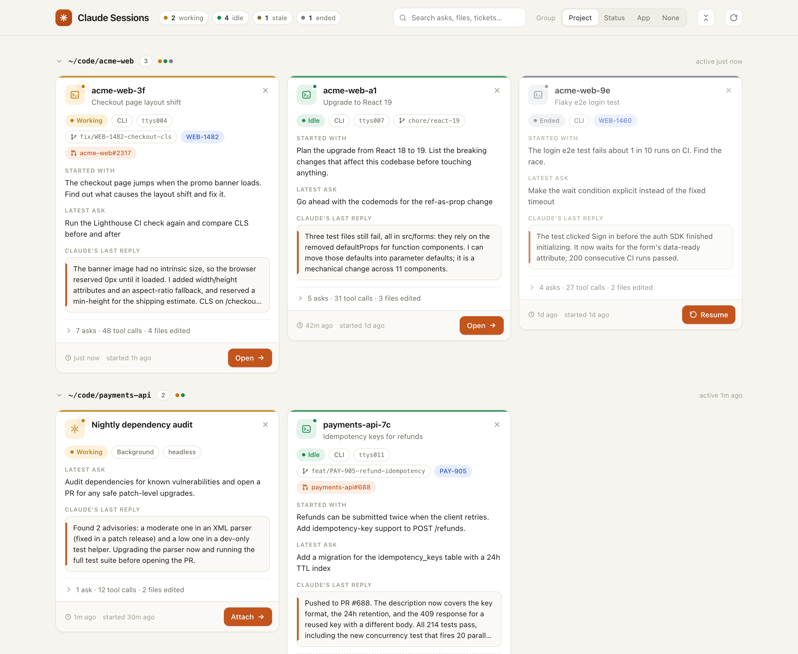
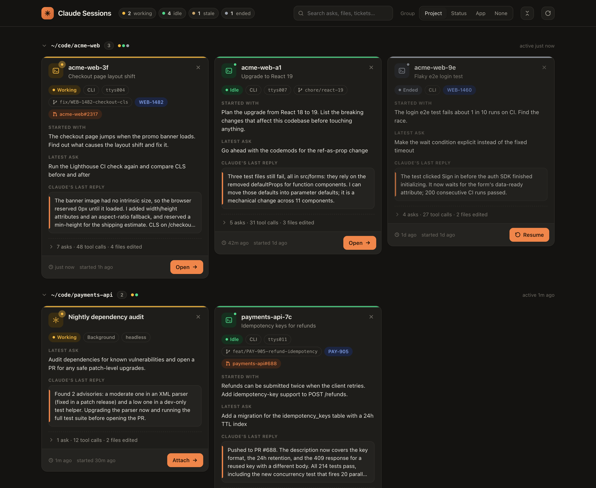
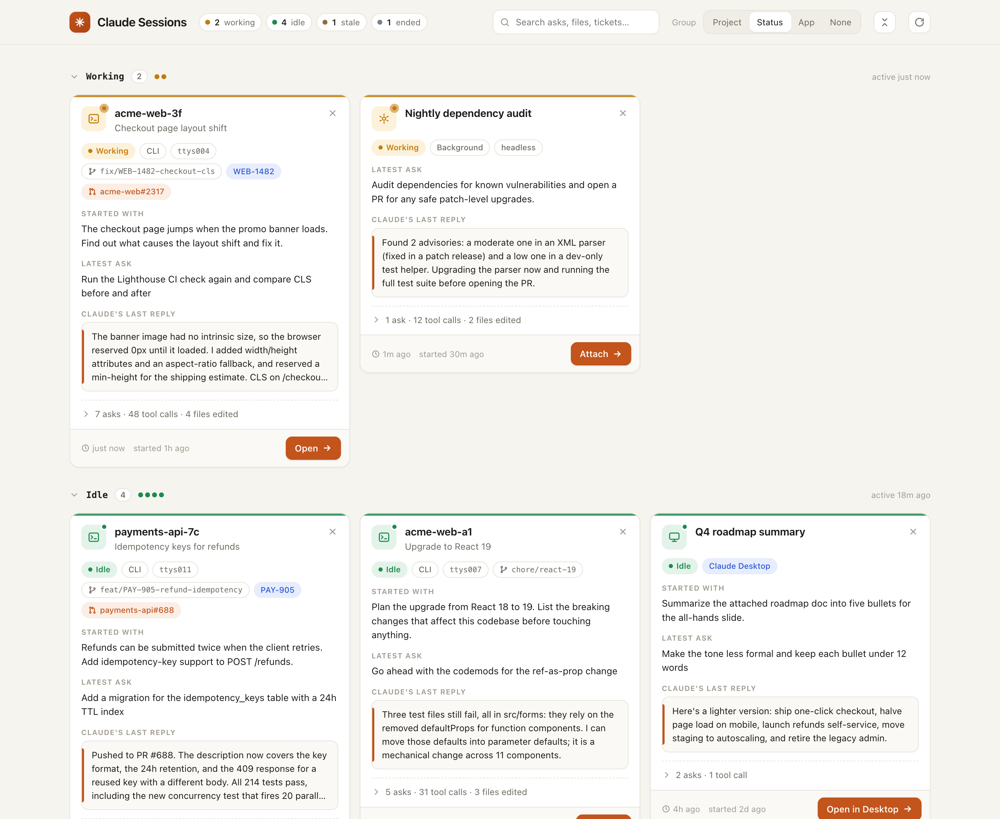

# Claude Sessions Dashboard

A local web dashboard for every Claude session running on your Mac: Claude Code CLI sessions, background jobs and Claude Desktop chats.

Each session is a card that reminds you what it was about. The card shows the first and latest asks, Claude's last reply, the git branch, Jira tickets, PRs, files edited and tools used. You can open, attach to, resume or close a session from its card.



<table>
  <tr>
    <td width="50%"></td>
    <td width="50%"></td>
  </tr>
  <tr>
    <td align="center"><sub>Follows the system dark mode</sub></td>
    <td align="center"><sub>Group by project, status, app, or not at all</sub></td>
  </tr>
</table>

<sub>Screenshots use the made-up sessions in <code>demo/sessions.json</code> (<code>python3 server.py --demo</code>).</sub>

## Features

- **Cards grouped by project**, status (working / idle / stale / ended), or app (CLI / Desktop / background). Groups collapse and expand, and your choice is remembered.
- **Context at a glance:** first ask, latest ask, Claude's last reply, git branch, Jira tickets, PRs, plus earlier asks, edited files and tool usage behind an expandable row.
- **One-click Open** that goes to the exact Orca tab or Claude Desktop chat, attaches to headless background jobs, or resumes ended sessions (see below).
- **Close** with an in-card confirmation.
- **Search** across asks, replies, files, branches, tickets and PRs. Press `/` to focus it.
- **Live updates** every 10 seconds, with animations only for sessions that are new.

## Run

```sh
python3 server.py            # opens http://127.0.0.1:8765
python3 server.py --no-open  # don't open a browser
PORT=9000 python3 server.py  # different port
python3 server.py --demo     # made-up sessions from demo/sessions.json; actions do nothing
```

Add `?group=project|status|app|none` to the URL to choose the grouping.

Python 3 standard library only, macOS only.

## What Open does

| Session | Action |
|---|---|
| CLI session in [Orca](https://orca.stably.ai) | Switches to its exact Orca tab (via `orca terminal switch`) |
| CLI session in Terminal.app / iTerm2 | Selects the tab whose tty matches |
| CLI session in another terminal app | Brings that app to the front |
| Claude Desktop chat | Opens `claude://code/continue?session=local_…` |
| Background job parked in a terminal | Switches to that terminal |
| Headless background job | Opens a new Orca tab running `claude attach <id>`, then reuses that tab on later clicks |
| Ended session | Opens a new Orca tab (or Terminal.app window) running `claude --resume <id>` |

**Close** sends `SIGTERM` to the session process. For an ended session it removes the leftover entry.

## How it works

- **Sessions:** read from `~/.claude/sessions/*.json`, Claude Code's registry of live sessions.
- **Summaries:** parsed from the session transcripts in `~/.claude/projects/<project>/<sessionId>.jsonl`. Nothing is sent to a model.
- **Orca tabs:** matched to sessions through Orca's agent-hook registry (`~/Library/Application Support/orca/agent-hooks/last-status.json`) and `orca terminal list`.
- **Security:** the server listens only on `127.0.0.1`. The page's POST actions need a random token issued at startup, so other websites can't trigger them.

## Files

- `server.py`: HTTP server, session discovery, transcript summaries, open/close actions
- `index.html`: the dashboard UI (no build step, no dependencies)
- `demo/sessions.json`: made-up sessions for `--demo` and the screenshots
- `docs/`: README screenshots
- `attach-tabs.json`: local record of the Orca tabs Attach has opened (git-ignored)
